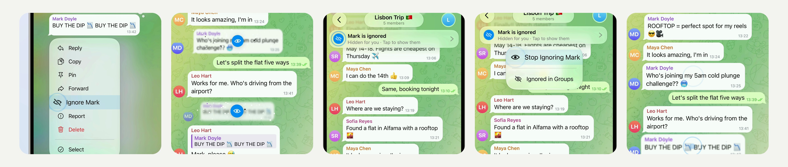

# Ignore in Groups - hide someone's messages in every group, and bring them back in one tap (iOS)

Someone in a group you can't leave keeps posting things you don't want to read? Hold one of their messages and choose
**Ignore**. Their messages fold away for you in every group, a line under the group's header says who is ignored, and
one tap on it brings them back. Only your device knows: nothing is sent, and they are not told.

[](Media/ignore-in-groups.mp4)

▶︎ [Media/ignore-in-groups.mp4](Media/ignore-in-groups.mp4) - the feature in the iOS Simulator (2160×2160, 60 fps, 19 s, loops).

Pure UIKit and Telegram's own components (the context menu, list items, the header panels), no new dependencies, no
server changes. 31 files, +2374 −38: one new module, a new file in the chat controller, and hooks in existing files.
Builds with the project's own `Make.py build` (`debug_sim_arm64`).

## How it works

- **The menu item.** Hold a message of someone else in a group (or in the comments of a channel): the menu has
  **Ignore Mark** with an eye. The first times it is seen it introduces itself: the row lights up and stays larger
  for a couple of seconds, the eye pops in turning, blinks and is crossed out, a ring goes out of it, the title rises
  letter by letter and light passes over the row.
- **Ignoring.** Their messages on screen go one after another, out from the one you held: each is drawn into an eye
  that pops up over it - it narrows, blurs and fades while its pieces swirl in - then the eye blinks, is crossed out
  and goes with a ring; their avatar goes with it. The chat closes up without them, and a toast offers Undo.
- **The line under the header.** "Mark is ignored · Hidden for you · Tap to show them" drops in under the group's
  header and stays larger for a moment; its eye is crossed out, rings go out, the text comes in letter by letter. It
  stays while the chat is open. A tap opens **Stop Ignoring Mark** (which introduces itself the same way, the eye
  opening) and **Ignored in Groups**.
- **Bringing back.** Their messages come back where they were, each out of an eye that opens: pieces fly out to their
  places and the message unfolds out of a blur; the avatars pop back in.
- **Everywhere else.**
  - A reply to an ignored person shows "Message from someone you ignore" instead of their text or picture.
  - In the chat list, a group whose last message is theirs shows "Hidden message".
  - In-app banners for their messages are not shown.
  - Voice messages that play one after another skip theirs, so nothing of theirs is played or marked as listened.
  - Mentions of you in their hidden messages are taken as seen as you scroll past them, so the "@" badge goes.
- **Other ways in and out.** The **…** menu of a person's profile has **Ignore in Groups** or **Stop Ignoring**, and
  **Settings → Privacy and Security → Ignored in Groups** lists everyone ignored (swipe to stop ignoring).

Private chats, a channel's own posts and a channel's direct messages are never affected; for those there is Block.

## Repository

| Path | What |
|---|---|
| `submodules/` | The changed and new files, at their paths in Telegram-iOS (whole files of commit `279f89e4d4` with the change). |
| `Telegram/` | The English strings (`Localizable.strings`). |
| `ignore-users.patch` | The same change as one patch. |
| `Media/ignore-in-groups.mp4` | Demo. |
| `Media/preview.jpg` | Stills from the demo. |

Where the code lives:

| File | What |
|---|---|
| `TelegramUI/Components/IgnoredMembers/` | **New module.** Who is ignored, per account, on the device (`IgnoredMembers.swift`); the menu item (`IgnoreMenuItem.swift`); the eye (`IgnoreEyeView.swift`); drawing messages into eyes and back (`IgnoreEffects.swift`); the line under the header (`IgnoredChatPanelComponent.swift`); the Ignored in Groups list (`IgnoredMembersController.swift`); shared animations. |
| `TelegramUI/Sources/Chat/ChatControllerIgnoredMembers.swift` | **New.** The chat: ignoring with the effect, bringing back, the line and its menu. |
| `ChatHistoryEntriesForView.swift`, `ChatHistoryListNode.swift` | Their messages are left out of the history; loading goes on past them; mentions in them are taken as seen. |
| `ChatInterfaceStateContextMenus.swift` | The Ignore item in a message's menu. |
| `ChatController.swift`, `ChatControllerNode.swift`, `UpdateChatPresentationInterfaceState.swift` | The line under the header and its entrance. |
| `ChatMessageReplyInfoNode.swift`, `ChatListItem.swift`, `ChatListNode.swift`, `ApplicationContext.swift` | Replies, the chat list and in-app banners. |
| `PeerMessagesMediaPlaylist.swift` | Voice messages playing in a row skip theirs. |
| `PeerInfoScreenPerformButtonAction.swift`, `PrivacyAndSecurityController.swift` | The profile menu item and the list in Privacy and Security. |
| `ChatMessageDateHeader.swift` | Whose avatar a gutter avatar is (for the effect). |
| `Localizable.strings`, `BUILD` files | Strings and the new dependencies. |

## Apply

Applies cleanly to [TelegramMessenger/Telegram-iOS](https://github.com/TelegramMessenger/Telegram-iOS) `master`
(`279f89e4d4f63f17227bf877dc3d8990f22ecd58`):

```sh
git apply ignore-users.patch
```

or, on that commit only, copy `submodules/` and `Telegram/` over the repository (they are whole files: on a newer
`master` use the patch). Then build as described in the Telegram-iOS README.

## Notes and limits

- The group in the video is staged for the demo: four fictional people (Sofia Reyes, Leo Hart, Maya Chen and Mark
  Doyle), the group "Lisbon Trip" and its messages, stored on the simulator; nothing was sent to a server.
  Those are part of the recording setup only, not of the patch; everything else is the app running this code. A few
  frames of the scroll and of the line's entrance, which the simulator recorded at a lower rate, were filled in
  between the recorded ones.
- The list of ignored people is kept on this device (per account), not synced to other devices.
- System notifications shown by iOS (the notification service extension) still show their messages; search in a chat
  still finds them.
- Only English strings are added; other languages fall back to them.
- Checked in the simulator: the menu item, ignoring and its effect, the line and its menu, bringing back, replies to
  an ignored person, the Ignored in Groups list (opened from the line) and stopping from it; a clean build of the
  patch. Not checked: the chat list preview, Undo, the profile item and the Privacy and Security entry in use; on a
  device, in a release build, with very large groups.

## License

An unofficial change to [Telegram-iOS](https://github.com/TelegramMessenger/Telegram-iOS), not affiliated with Telegram,
published openly so that it can be used under the terms of the original project.
